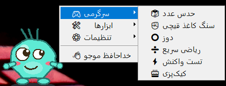

**English**

Mojo is a fun and interactive desktop companion developed in Python for Windows.  
It features mini-games, quizzes, jokes, fun facts, and interactive animations.  
It can provide useful reminders, health tips, and personalized daily challenges.  
Mojo remembers user preferences, tracks progress, and offers rewards and customization options.  
Its goal is to make desktop use more enjoyable while combining entertainment with useful everyday features.

-----------------------

**فارسی**

موجو (Mojo) یک دستیار دسکتاپ سرگرم‌کننده و تعاملی است که با پایتون برای ویندوز توسعه داده شده است.  
این برنامه شامل بازی‌های کوچک، آزمون‌های اطلاعات عمومی، جوک، دانستنی‌ها و انیمیشن‌های تعاملی است.  
موجو می‌تواند یادآوری‌های مفید، نکات سلامتی و چالش‌های روزانه ارائه دهد.  
این برنامه علایق کاربر را به خاطر می‌سپارد، پیشرفت او را دنبال می‌کند و امکانات شخصی‌سازی و دریافت پاداش دارد.  
هدف موجو، لذت‌بخش‌تر کردن کار با دسکتاپ و ترکیب سرگرمی با قابلیت‌های کاربردی روزمره است.

